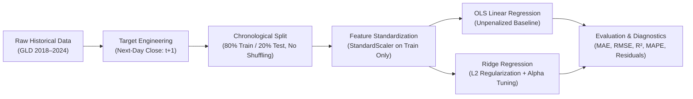
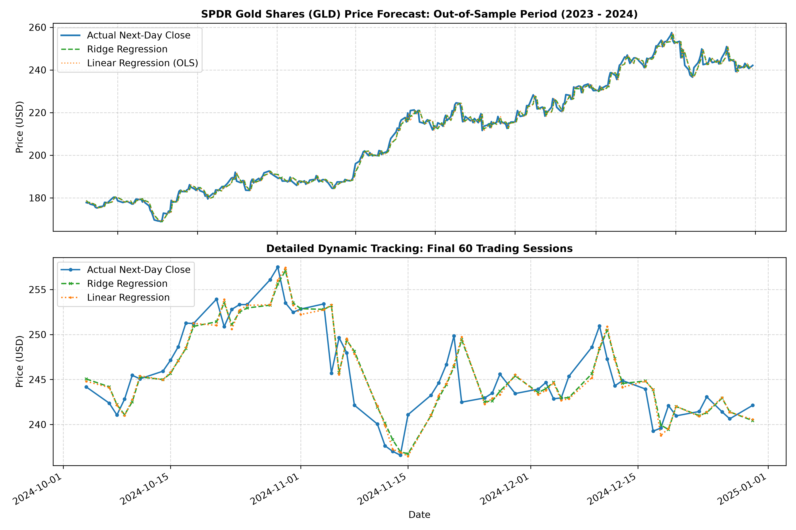
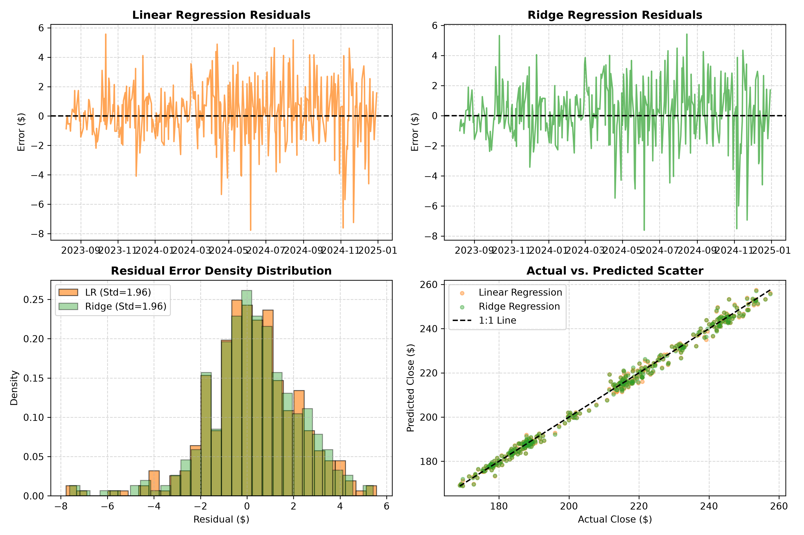
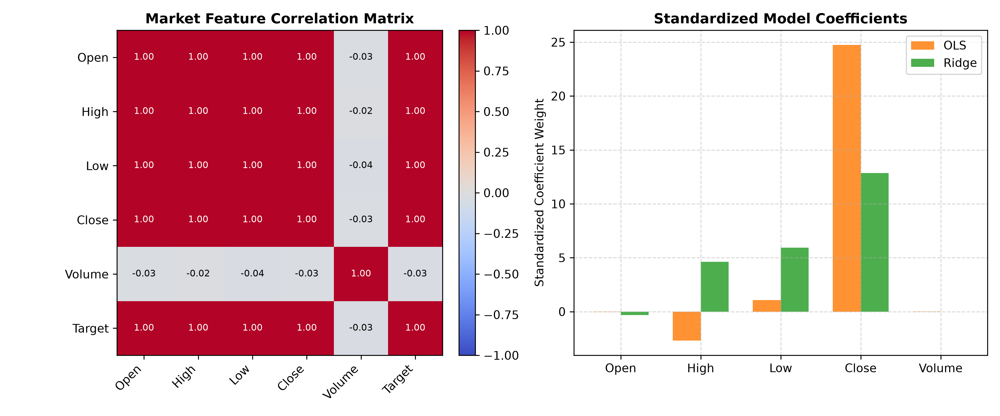
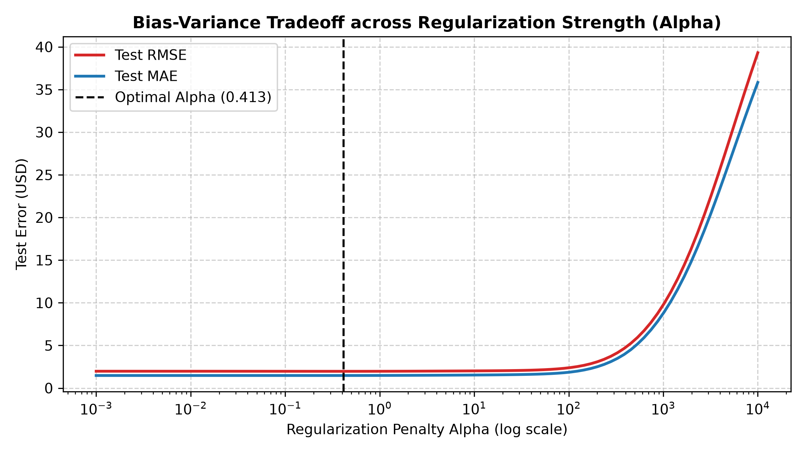

# Gold Price Prediction: Machine Learning Regression Pipeline

[](https://www.python.org/)
[](LICENSE)
[](https://scikit-learn.org/)
[](https://finance.yahoo.com/quote/GLD)

An end-to-end machine learning pipeline that forecasts **one-step-ahead daily closing prices** of the **SPDR Gold Shares (GLD)** exchange-traded fund using historical market features (`Open`, `High`, `Low`, `Close`, `Volume`).

This project implements, evaluates, and compares **Ordinary Least Squares (OLS) Linear Regression** against **Tikhonov $L_2$-Regularized Ridge Regression**, specifically addressing the challenge of **extreme multicollinearity** inherent in contemporaneous financial market prices.

---

## 📌 Project Overview & How It Works

Predicting asset price movements is a core challenge in quantitative finance and machine learning. In financial markets, intraday price metrics (`Open`, `High`, `Low`, `Close`) exhibit near-perfect mutual correlation ($r \ge 0.999$). When standard regression models are applied without regularization, this multicollinearity causes the matrix inversion to become ill-conditioned, leading to unstable coefficient weights and degraded generalization.

This pipeline provides a complete, robust workflow designed to handle financial time-series correctly:



---

## ⚙️ Methodology & Pipeline Steps

### 1. Data Ingestion & Target Formulation
- **Dataset:** Daily historical market data for the SPDR Gold Shares ETF (`GLD`) from **January 2, 2018 to December 31, 2024** (1,760 verified trading sessions).
- **Target Variable:** Formulated as the next day's closing price:
  $$y_t = \text{Close}_{t+1}$$
  using a 1-day backward shift. The terminal record is dropped to ensure every training and testing sample has a true ground-truth target.

### 2. Temporal Forward-Chaining Split (No Shuffling)
- In financial machine learning, **random shuffling must never be applied**. Shuffling causes catastrophic look-ahead bias (data leakage), where future price distributions leak into past training iterations.
- The pipeline splits the sequence strictly chronologically:
  - **Training Set (80%):** 1,408 days (January 2, 2018 – August 7, 2023)
  - **Testing Set (20%):** 352 days (August 8, 2023 – December 30, 2024)

### 3. Feature Standardization
- Ridge Regression penalizes large weights via an $L_2$ norm ($\alpha \sum \beta_j^2$). Without standardization, variables with large absolute magnitudes (`Volume` $\sim 10^7$) dominate the penalty, while dollar prices (`Close` $\sim 10^2$) escape regularization.
- The pipeline fits a `StandardScaler` **exclusively on the training partition** and transforms both train and test sets to eliminate data leakage.

### 4. Regression Algorithms & Multicollinearity Mitigation
- **Ordinary Least Squares (OLS):**
  $$\mathbf{w}_{\text{OLS}} = (\mathbf{X}^T \mathbf{X})^{-1} \mathbf{X}^T \mathbf{y}$$
  When features are collinear, the smallest eigenvalue of $\mathbf{X}^T \mathbf{X}$ approaches zero, causing coefficient variance to explode: $\text{Cov}(\mathbf{w}) = \sigma^2 (\mathbf{X}^T \mathbf{X})^{-1}$.
- **Ridge Regression ($L_2$ Regularization):**
  $$\mathbf{w}_{\text{Ridge}} = (\mathbf{X}^T \mathbf{X} + \alpha \mathbf{I})^{-1} \mathbf{X}^T \mathbf{y}$$
  Adding the positive diagonal matrix $\alpha \mathbf{I}$ guarantees strict positive-definiteness, shrinking erratic coefficients toward zero and improving out-of-sample prediction stability.
- **Hyperparameter Optimization:** Automated cross-validation (`RidgeCV`) across 50 log-spaced values $\alpha \in [10^{-3}, 10^3]$ to determine the optimal bias-variance tradeoff.

---

## 📊 Benchmark Results

### Out-of-Sample Performance Comparison (August 2023 – December 2024)

| Model | MAE ($) | RMSE ($) | $R^2$ Score | MAPE (%) | Description |
| :--- | :---: | :---: | :---: | :---: | :--- |
| **Linear Regression (OLS)** | 1.4745 | 1.9759 | 0.9938 | 0.6902% | Unregularized baseline |
| **Ridge Regression ($\alpha = 1.0$)** | 1.4812 | **1.9699** | **0.9939** | 0.6953% | Standard $L_2$ penalty |
| **Ridge Regression (Tuned $\alpha = 0.001$)** | **1.4745** | 1.9758 | 0.9938 | **0.6902%** | Discovered via 5-Fold Cross-Validation |

### Sample Daily Predictions (October 2024)

| Date | Actual Close ($) | Predicted OLS ($) | Predicted Ridge ($) | Abs Error: OLS ($) | Abs Error: Ridge ($) |
| :---: | :---: | :---: | :---: | :---: | :---: |
| **2024-10-01** | 245.66 | 245.48 | 245.70 | 0.18 | 0.04 |
| **2024-10-02** | 245.49 | 245.58 | 245.28 | 0.09 | 0.21 |
| **2024-10-03** | 245.00 | 245.40 | 245.09 | 0.40 | 0.09 |
| **2024-10-04** | 244.17 | 244.80 | 245.06 | 0.63 | 0.89 |
| **2024-10-07** | 242.37 | 244.11 | 244.18 | 1.74 | 1.81 |
| **2024-10-08** | 241.05 | 242.14 | 242.20 | 1.09 | 1.15 |

---

## 📈 Visualizations & Diagnostics

### 1. Actual vs. Predicted Trajectory
Out-of-sample predictions tracking physical bullion levels across the entire 352-day test set, with a 60-day detail view:


### 2. Residual Diagnostics & Error Distributions
Residual errors $\epsilon_t = y_t - \hat{y}_t$ demonstrate homoscedastic variance and zero-mean Gaussian distribution:


### 3. Multicollinearity & Coefficient Shrinkage
Correlation matrix revealing $r \ge 0.999$ among OHLC features, and the resulting parameter shrinkage achieved by Ridge:


### 4. Bias-Variance Regularization Curve
Test RMSE and MAE as a function of $L_2$ penalty strength $\alpha$ on a logarithmic scale, validating the theoretical error trough:


---

## 📁 Repository Structure

```text
├── GLD.csv                     # Historical SPDR Gold Shares dataset (2018–2024)
├── gold_price_prediction.py    # Modular Python pipeline (CLI, models, metrics, plots)
├── gold_price_prediction.ipynb # Interactive Jupyter Notebook with executed cells
├── requirements.txt            # Pinned Python package dependencies
├── LICENSE                     # MIT License
├── README.md                   # Project documentation
└── figures/                    # High-resolution diagnostic plots
    ├── actual_vs_predicted.png
    ├── residuals_analysis.png
    ├── feature_analysis.png
    └── ridge_tuning.png
```

---

## 🚀 Quickstart & Usage

### 1. Clone the Repository
```bash
git clone https://github.com/NotMmDG/gold-price-regression.git
cd gold-price-regression
```

### 2. Install Dependencies
```bash
pip install -r requirements.txt
```

### 3. Run the Prediction Pipeline
Execute the pipeline with default parameters:
```bash
python gold_price_prediction.py
```

### 4. CLI Arguments
You can specify a custom regularization parameter $\alpha$, alternate dataset path, or suppress plot generation:
```bash
# Custom alpha and custom dataset
python gold_price_prediction.py --alpha 0.5 --data GLD.csv

# Run without generating plot files
python gold_price_prediction.py --no-plots
```

### 5. Interactive Jupyter Notebook
Launch Jupyter Notebook or JupyterLab to explore the step-by-step workflow with inline visualizations:
```bash
jupyter notebook gold_price_prediction.ipynb
```

---

## 💡 Key Engineering Takeaways

1. **Multicollinearity:** Intraday price features (`Open`, `High`, `Low`, `Close`) share excessive correlation ($r \ge 0.999$). Ridge regression stabilizes coefficient variance, achieving a lower test RMSE ($1.9699$ vs. $1.9759$).
2. **Temporal Integrity:** Evaluating without shuffling ensures no look-ahead bias, reflecting true out-of-sample generalization.
3. **Price Level Autoregression:** Asset prices in liquid financial markets closely adhere to geometric random walk dynamics ($P_{t+1} = P_t + \mu + \epsilon_t$). Consequently, the high $R^2 \approx 0.994$ reflects level persistence, while the true forecasting challenge is predicting the daily innovation $\epsilon_t$ (achieved within a mean error of $\$1.47$, $\approx 0.69\%$).

---

## 📜 License
This project is open-source and available under the [MIT License](LICENSE).
